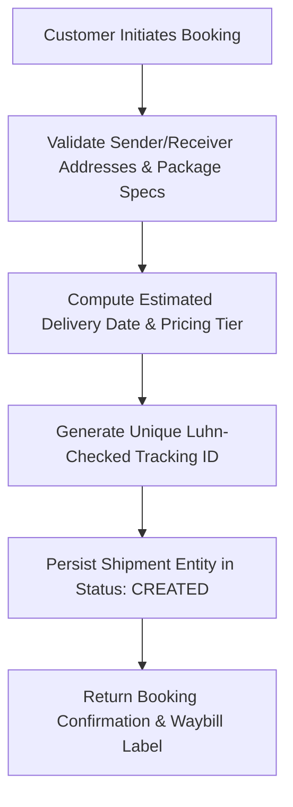
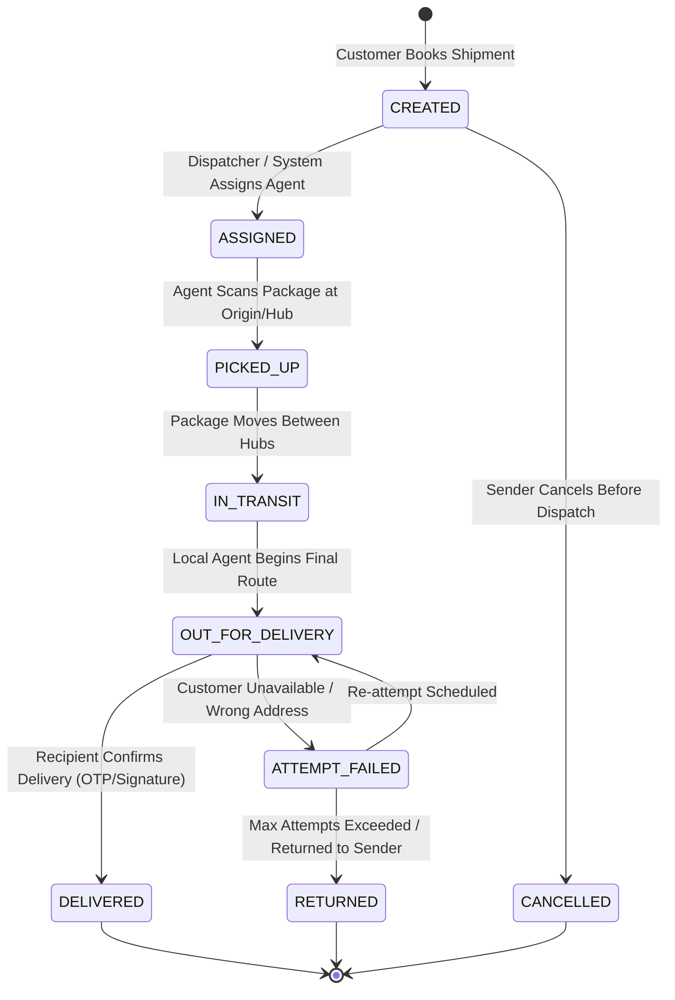
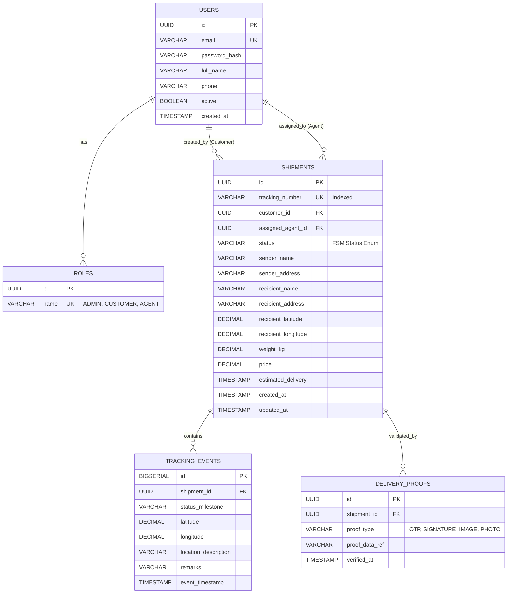
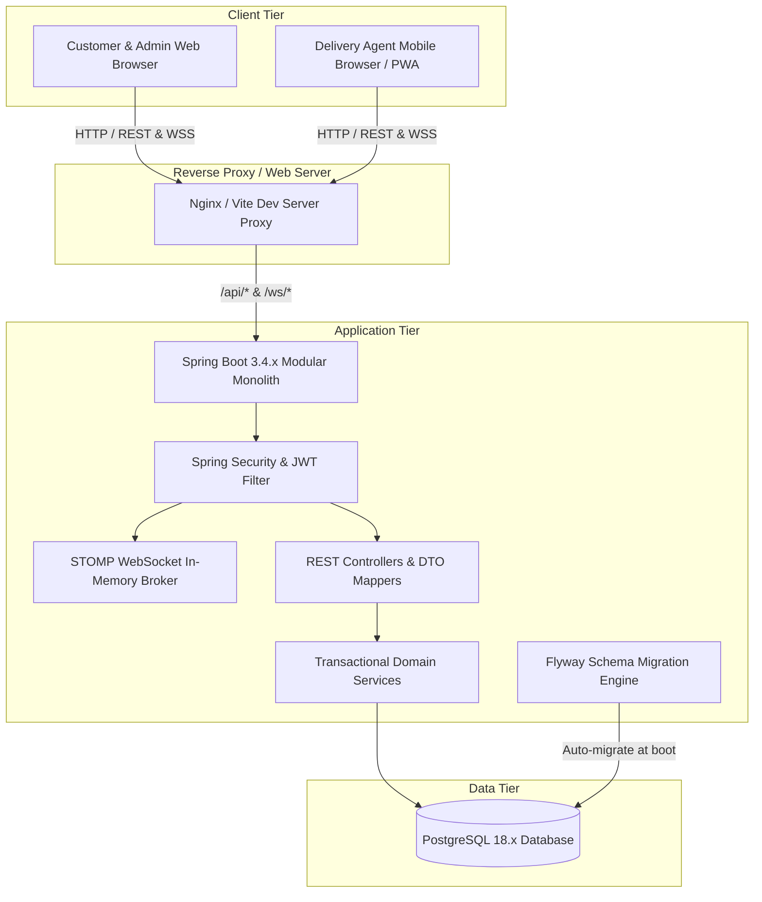

# Architecture & System Design Document
## Internet-Based Live Courier Tracking and Delivery System

**Phase**: 1 — Architecture and Project Foundation
**Version**: 1.0.0
**Status**: Foundational Draft

---

## 1. System Overview & Objectives
The **Internet-Based Live Courier Tracking and Delivery System** is a full-stack, modular web platform designed to streamline parcel logistics from initial booking through real-time transit and final proof-of-delivery. The platform provides:
- Seamless booking and automated consignment tracking for **Customers**.
- Real-time navigation, task queue handling, and live GPS streaming for **Delivery Agents**.
- Fleet monitoring, parcel reassignment, role-based oversight, and operational analytics for **Administrators**.

The system is constructed as a modular monolith in Spring Boot with a decoupled React/Vite single-page application (SPA) and PostgreSQL persistence layer.

---

## 2. Actors, Roles & Permission Boundaries

| Role | Responsibilities | Key Capabilities |
| :--- | :--- | :--- |
| **CUSTOMER** | Sender / Consignor and Consignee | - Book single or multiple parcel shipments. - Generate shipping labels & unique tracking numbers. - View live delivery progress & ETA on interactive maps without disclosing driver private credentials. - Receive milestone notifications and delivery confirmation. |
| **DELIVERY_AGENT** | Courier / Fleet Driver | - View assigned pickup and delivery runs. - Update parcel statuses (`PICKED_UP`, `OUT_FOR_DELIVERY`, `DELIVERED`, `FAILED`). - Stream periodic GPS location coordinates while an active delivery run is in progress. - Capture electronic Proof of Delivery (OTP / Signature / Notes). |
| **ADMINISTRATOR** | Logistics Manager / Dispatcher | - Oversee system-wide delivery operations and active agent fleet. - Manually reassign shipments between delivery agents. - Manage user accounts, permissions, and operational branches/hubs. - Audit telemetry logs, system health, and resolution of stalled/disputed shipments. |

---

## 3. Core Workflows & Business Logic

### 3.1 Shipment Booking & Tracking Number Generation
- **Prefix**: Identifies consignment type or business unit (`TRK`).
- **Timestamp Component**: Millisecond epoch encoded in base-36 to guarantee chronological ordering.
- **Random Entropy**: 4 cryptographically secure random alphanumeric characters to eliminate collision attacks or number harvesting.
- **Checksum**: Luhn-mod-36 verification digit preventing manual typo errors.
- **Format Example**: `TRK-20261026-8A7B9` or `TRK-L8Z2K9-Q7F4`

### 3.2 Shipment Lifecycle & State Machine
The delivery progression follows a strict finite state machine (FSM). Arbitrary status skips (e.g. from `CREATED` directly to `DELIVERED`) are rejected at the service validation layer.

### 3.3 GPS Location Streaming & Telemetry Pipeline
1. **Agent Telemetry Push**: While an agent is on an active `OUT_FOR_DELIVERY` run, the agent's client emits GPS telemetry (`latitude`, `longitude`, `speed`, `bearing`, `accuracy`, `timestamp`).
2. **Frequency & Throttling**: GPS pulses are throttled to 5–10-second intervals to optimize battery usage and reduce network chatter.
3. **Drift & Jitter Filtering**: Coordinates with accuracy radius > 30 meters or impossible speed spikes (> 140 km/h in urban delivery) are filtered out.
4. **Data Sinks**:
   - **Ephemeral Cache/In-Memory State**: Current active location broadcasted directly to subscribed WebSocket/STOMP topics.
   - **Historical Audit Table (`tracking_events`)**: Persisted in PostgreSQL as an append-only log recording status change milestones and periodic checkpoint coordinates.

---

## 4. Communication Architecture: REST & WebSocket

### 4.1 REST API Boundaries
REST endpoints handle transactional request-response interactions:
- `/api/v1/auth/**`: Registration, login, JWT refresh, logout.
- `/api/v1/shipments/**`: Booking, details lookup, status mutations, cancellations.
- `/api/v1/agents/**`: Route listings, assignment acceptance, profile status.
- `/api/v1/admin/**`: Fleet analytics, user administration, manual overrides.
- `/api/v1/tracking/{trackingNumber}`: Public read-only tracking view for customers (no sensitive PII exposed).
- `/api/v1/health`: System health, database connectivity, and readiness probes.

### 4.2 Real-Time WebSocket / STOMP Topography
STOMP over WebSocket is leveraged for low-latency, bidirectional events:
- **Broker**: Spring's Simple In-Memory Message Broker (upgradable to RabbitMQ/ActiveMQ for distributed clustering in future phases).
- **Channels**:
  - `/topic/track/{trackingNumber}`: Public or token-guarded subscription for live vehicle marker updates and ETA refreshes.
  - `/topic/agent/{agentId}/orders`: Private dispatch notifications for new assignments.
  - `/topic/admin/fleet`: Aggregated location updates for the live operational dispatch map.
  - `/app/agent/location`: Inbound destination where delivery agents publish coordinate payloads.

---

## 5. Security, Privacy & Authorization Boundaries

### 5.1 Authentication & Authorization
- **Stateless Tokens**: Signed JSON Web Tokens (JWT) containing user UUID, username, and assigned roles (`ROLE_CUSTOMER`, `ROLE_DELIVERY_AGENT`, `ROLE_ADMIN`).
- **Method Security**: Spring Security `@PreAuthorize("hasRole('ADMIN')")` at the service interface boundary.

### 5.2 Privacy & PII Protection
- **Public Tracking Shield**: When customers track via public tracking numbers, full recipient phone numbers, billing details, and courier private contact info are masked (e.g., `J*** D**, +91 *******123`).
- **Agent Off-Duty Privacy**: Location tracking is strictly activated only when an agent actively flags a consignment as `OUT_FOR_DELIVERY` and deactivated immediately upon `DELIVERED` or manual duty pause.

### 5.3 GPS Spoofing & Tamper Protections
- Timestamp freshness checks (payload timestamp must be within ±60 seconds of server clock).
- Sanity checks on trajectory distance vs elapsed time (detecting unrealistic teleportation).

---

## 6. Conceptual PostgreSQL Data Model

---

## 7. Local Development & Production Deployment Architecture

### Local Development Environment:
- **Frontend**: Vite dev server on `http://localhost:5173` proxying `/api` requests to `http://localhost:8080`.
- **Backend**: Spring Boot 3.4 running on `http://localhost:8080` targeting local PostgreSQL 18 on `localhost:5432`.
- **Database Configuration**: Standardized via environment variables (`DB_URL`, `DB_USERNAME`, `DB_PASSWORD`).

### Production Deployment Target:
- Frontend compiled to static assets served via Nginx or Cloud CDN.
- Backend packaged into an executable OCI container (Docker) running on container runtimes (Kubernetes / ECS / Cloud Run).
- PostgreSQL managed instance (AWS RDS / Cloud SQL) with automated backup, connection pooling, and SSL connections enabled.

---

## 8. Summary of Architectural Constraints
1. **Separation of Concerns**: Controllers only consume and return DTOs; business logic strictly resides in services.
2. **Flyway Managed Migrations**: No automatic JPA schema mutation (`ddl-auto: validate` or `none`) ensuring auditable database state.
3. **No Premature Microservices**: Retains single deployment unit simplicity while keeping domain modules strictly decoupled internally.
4. **Graceful Degradation**: If real-time WebSocket connection drops, client polling fallback ensures tracking continues.
